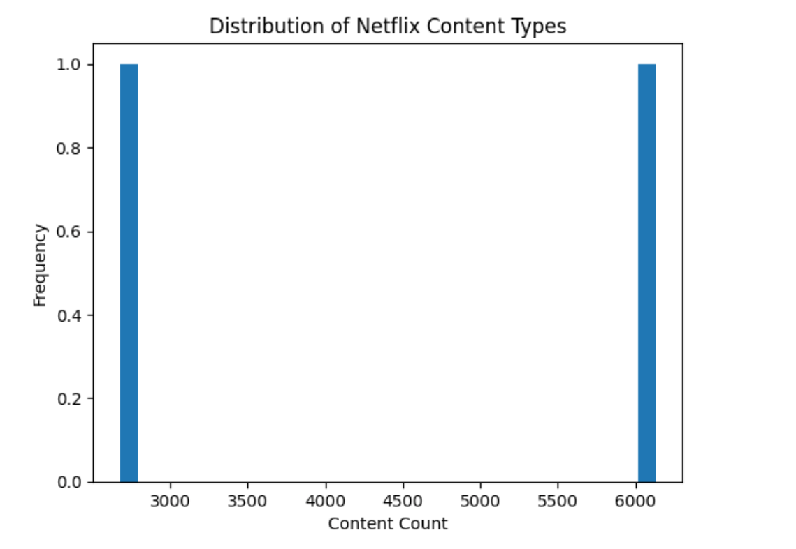

# 🎬 Netflix Data Analytics

# 📌 Project Overview

- This project focuses on analyzing Netflix movies and TV shows to understand content distribution, ratings, country-wise contributions, and release-year trends.
- It demonstrates an end-to-end Data Analytics workflow, including data cleaning, missing value treatment, exploratory data analysis (EDA), data visualization, and business insight generation using Python.
- The dataset contains real-world data quality issues, such as missing values in director, cast, country, rating, and duration columns, making this project useful for practicing data analyst skills.

# 🎯 Project Objectives

- Load and understand the Netflix dataset
- Clean and preprocess raw data
- Handle missing values using appropriate methods
- Perform Exploratory Data Analysis (EDA)
- Visualize data using Matplotlib and Seaborn
- Analyze content types, ratings, countries, and release years
- Generate meaningful business insights from Netflix content data

# 🛠️ Skills & Tools Used (ATS Optimized)

- Python
- NumPy
- Pandas
- Data Cleaning & Preprocessing
- Missing Value Treatment
- Exploratory Data Analysis (EDA)
- Data Visualization
- Matplotlib
- Seaborn
- Correlation Analysis
- Business Analytics
- Data Interpretation

# 📂 Dataset Information

**Dataset Name:** Netflix Movies and TV Shows Dataset  
**Data Source:** Kaggle — Netflix Movies and TV Shows  
**Rows:** 8,807  
**Columns:** 12  
**Target Variable:** Not applicable (exploratory data analysis project; no prediction target)

**Key Features:**

- **Content information:** `show_id`, `title`, `type`
- **People involved:** `director`, `cast`
- **Geographic information:** `country`
- **Release details:** `date_added`, `release_year`
- **Content classification:** `rating`, `listed_in`
- **Additional details:** `duration`, `description`

# 🔍 Project Workflow

## 1️⃣ Data Loading & Understanding

- Imported the required Python libraries.
- Loaded the Netflix dataset using Pandas.
- Checked the dataset shape, column names, data types, and summary information.
- Identified missing values and checked for duplicate records.

## 2️⃣ Data Cleaning & Preprocessing

- Inspected data types and column names.
- Reviewed missing values in important columns.
- Prepared the dataset for exploratory analysis.
- Checked duplicate records to maintain data consistency.

## 3️⃣ Missing Value Treatment

**Missing values were found in:**

1. `director`
2. `cast`
3. `country`
4. `date_added`
5. `rating`
6. `duration`

**Method Used:**

- Missing values in the selected columns were replaced with `Unknown`.
- Rechecked the dataset to confirm that no null values remained after treatment.

## 4️⃣ Exploratory Data Analysis (EDA)

**EDA was performed using:**

1. Bar charts
2. Pie charts
3. Boxplots
4. Histograms
5. Correlation heatmaps

**Key Analysis Areas:**

1. Distribution of Movies and TV Shows
2. Distribution of content ratings
3. Country-wise content contributions
4. Release-year distribution
5. Comparison of release years across content types

## 5️⃣ Data Preparation for Visualization

- Converted selected categorical values into numeric values when needed for limited correlation analysis.
- Selected appropriate columns for each visualization.
- Used Pandas for grouping, counting, and summarizing data.
- Prepared the results for clear graphical representation.

## 6️⃣ Content-Wise Analysis

Netflix content was analyzed across:

- Movies
- TV Shows
- Content ratings
- Country-wise contributions
- Different release-year ranges

This helped in understanding the composition and diversity of the Netflix content library.

## 7️⃣ Data Visualization Dashboard

- Created visualizations using:
  - Matplotlib
  - Seaborn
- Used different chart types to present the findings.
- Designed the analysis to help readers understand the results without needing to inspect the raw dataset.

## 1. Distribution of Netflix Content Types

## Analysis:

Movies account for the majority of titles in the Netflix dataset.

TV Shows represent a smaller share of the available titles.

The comparison highlights the distribution of different content formats.

## Conclusion:

Netflix's content library in the analyzed dataset is dominated by Movies, while TV Shows account for a smaller proportion of the total titles.

## 📊 Key Insights

1. Movies account for a larger share of titles than TV Shows in the dataset.
2. Content ratings help describe the different audience categories represented in Netflix's library.
3. Country-wise analysis highlights the countries associated with the most titles.
4. Release-year analysis shows how Netflix titles are distributed across different periods.
5. Boxplots help compare release-year distributions and identify potential outliers.

## 📈 Business Recommendations

1. Analyze the performance and audience engagement of Movies and TV Shows separately.
2. Use rating and genre information to understand the variety of content available for different audience groups.
3. Explore country-wise content distribution when evaluating content diversity and regional representation.
4. Study release-year patterns alongside viewing data before making content acquisition or renewal decisions.
5. Combine this analysis with viewership, engagement, and subscriber data to develop stronger business insights.

## ⚠️ Limitations & Assumptions

**Limitations:**

- The dataset does not contain actual viewership, revenue, or subscriber engagement metrics.
- Some titles have missing or incomplete metadata.
- Correlation analysis is limited because most dataset columns are categorical or text-based.
- The analysis describes patterns in the dataset and does not establish causation.

**Assumptions:**

- The dataset accurately represents the records provided in the source file.
- Missing values replaced with `Unknown` represent unavailable information, not a real category.
- Each row represents one Netflix title in the dataset.

# 🏁 Final Conclusion

This project demonstrates an end-to-end data analysis workflow using the Netflix Movies and TV Shows dataset. Through data cleaning, missing value treatment, exploratory data analysis, and visualization, meaningful insights were developed about content types, ratings, country-wise contributions, and release-year patterns.

The project strengthened practical skills in Python, Pandas, NumPy, Matplotlib, Seaborn, and business insight generation. It also demonstrates how data analysis can turn raw data into understandable findings that support further investigation and data-driven decision-making.
